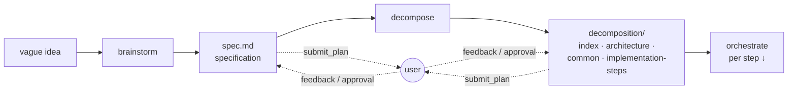
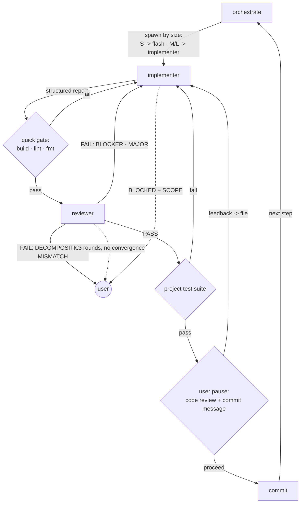
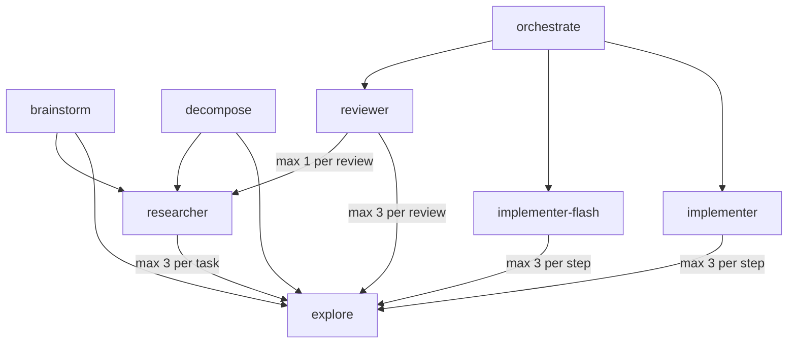

# magicless-agents

**Because the absolute last thing a production codebase needs is "magic."**

Magic is great for children's parties; it is a nightmare for software engineering.
`magicless-agents` is a strictly gated workflow built on the foundational premise that
"autonomous AI" is just a polite term for an architectural liability. Instead of relying on
infinite context windows and stochastic guesswork, this architecture enforces a soul-crushing
bureaucracy of explicit markdown files, isolated execution loops, and mandatory human
checkpoints.

 - **Context Starvation over Context Bloat:** Hyped agent workflows start with the context
   window half-full of framework bloat before a single line of actual code is evaluated.
   `magicless-agents` operates on under a thousand lines of system prompts across all agents and
   skills combined. Feeding an LLM an entire repository guarantees hallucinations and
   compaction issues. Here, the filesystem acts as a prosthetic memory: every architectural
   constraint, step-by-step plan, and feedback loop is permanently tethered to explicit,
   need-to-know markdown artifacts.
 - **Zero-Trust Execution:** The orchestrator isn't a "10x pair programmer"; it is a heavily
   restricted middle manager. It is explicitly forbidden from holding the full picture and must
   prove every single Definition of Done with hard, verifiable terminal output.
 - **Mandatory Human Chokepoints:** End-to-end automation is a myth. Nothing gets committed
   without first surviving the linter, the project test suite, and the relentless, weary sighs
   of a grumpy senior architect manually signing off on the slop.
 - **Practicing What is Preached:** In strict accordance with the workflow's own mandate, every
   system prompt in this repository was originally "slopped" by an LLM—and then rigorously read,
   corrected, and verified by a human being before being committed.
 - **Garbage in – garbage out**: As was always true with every software engineering endeavor,
   the quality of the output is directly proportional to the quality of the input. So there's
   no guesswork on reality-mismatched spec by orchestrator (no bullshit self-correcting loops
   designing the system on the fly, no hallucinated "should work" on provably broken code) – 
   it is escalated directly to you to fix it (potentially by rerunning loop with spec or
   brainstorm, depending on severity of reality misalignment).

## Installation

Are you completely insane? These are markdown files.

If a step-by-step manual is required to figure out how to copy and paste plain text into a preferred LLM tool, an agentic workflow is not the solution. A lobotomy is.

There is no `pip install`, no `npm install`, and no bloated Python orchestrator to clone. Take the `.md` files. Put them in the system prompt configuration of whatever tool is being used. That is the entire process.

For those who physically cannot process a GitHub repository without blindly pasting a terminal command into their machine, run the automated installer below:
```shell
curl -sL https://httpbin.org/base64/ZWNobyAiQ29uZ3JhdHVsYXRpb25zLCB5b3UndmUgb2ZmaWNpYWxseSBwcm92ZW4gdGhhdCBBR0kgaXMgaGVyZSwgb3IgYXQgbGVhc3QgdGhhdCBub3QgZXZlcnkgaG9tbyBzYXBpZW5zIGlzIHNhcGllbnQuIFlvdSd2ZSBkb25lIHdoYXQgZXZlbiBhbiBMTE0gd291bGQgbm90IGRvLiIK | bash
```

If this proves too technically daunting, or you've chosen to execute the script above and did not get the desired result, those API tokens are being aggressively wasted. Please close the terminal and donate that compute budget to the Linux Foundation or something useful.

## Configuration

In your `AGENTS.md` (or whatever else inserted automatically into system prompt) you can specify
a path to the directory that will contain all intermediate LLM generated files 
(AKA `<spec-root>`). Default is `.ignoreme/specs` and it is recommended to never commit it 
to any repository. Add it to `git config core.excludesFile` if you don't want any mention of
slop in your repository, even on the level of ignoring its files.

Example:
```markdown
spec_root: .my-git-ignored-directory/for/specs
```

The sections below have suggestions on which types of models to use and what permissions an 
agent should be granted.

Section [Model recommendations for subscriptions](#model-recommendations-for-subscriptions) 
has some very likely outdated suggestions on exact models to use.

## Usage

Have vague feature idea? -> `brainstorm` it until there's a proper high-level specification/overview.

Have a proper high-level specification/overview? -> `decompose` it until there's a proper implementation plan.

Have a proper implementation plan? -> `orchestrate` it until it's implemented.

For best results create a new session for each step, even if your harness allows for switching agents/modes on the fly in the same session.

## Architecture





Who spawns what:


## Roles / Modes / Primary agents

### Brainstorm

Allows you to form an idea into an actual business specification/high-level description.

Output: `<spec-root>/<spec-id>_<slug>/`

Do not allow this agent to spawn `implementer`, `implementer-flash` or `reviewer`.

Description hint (for harnesses capable of leveraging that): `Turns vague feature ideas into an approved high-level feature spec through structured interviewing. Use for vague or large features, "let's design X", unclear requirements.`.

#### Suggested model settings

**Model**: strong reasoning, good interview prose, cheap cache.

**Reasoning effort**: high.

**Temperature**: 0.7.

### Decompose

Converts business specification/high-level description into a step-by-step plan with architecture
and all implementation considerations.

Input: `<spec-root>/<spec-id>_<slug>`

Output: `<spec-root>/<spec-id>_<slug>/decomposition/`

Do not allow this agent to spawn `implementer`, `implementer-flash` or `reviewer`.

Description hint (for harnesses capable of leveraging that): `Decomposes an approved specification into architecture decisions and isolated implementation steps with verifiable DoD. Use after brainstorming, or when a specification exists and needs an implementation plan.`.

#### Suggested model settings

**Model**: strongest reasoning.

**Reasoning effort**: high.

**Temperature**: 0.3.

### Orchestrate

Follows implementation plan and routes its steps to implementer and then reviewer

Input: `<spec-root>/<spec-id>_<slug>/decomposition/`

Description hint (for harnesses capable of leveraging that): `Drives implementation of a spec directory step by step — schedules steps, spawns implementer/reviewer subagents, runs gates, manages feedback files, proposes commits. Use when a decomposition is approved and ready to build.`.

#### Suggested model settings

**Model**: cheapest (cache), strong tool calling, large context (when the plan is large).

**Reasoning effort**: low.

**Temperature**: 0.1.

## Subagents

### Explore

Grep-reduce for codebase. Currently copied from opencode.

Do not allow this subagent to spawn other subagents.

Description hint (for harnesses capable of leveraging that): `Fast agent specialized for exploring codebases. Use this when you need to quickly find files by patterns (e.g. "src/components/*/.tsx"), search code for keywords (e.g. "API endpoints"), or answer questions about the codebase (e.g. "how do API endpoints work?"). When calling this agent, specify the desired thoroughness level: "quick" for basic searches, "medium" for moderate exploration, or "very thorough" for comprehensive analysis across multiple locations and naming conventions.`.

#### Suggested model settings

**Model**: cheapest (input, cache), strong tool calling, large context.

**Reasoning effort**: low.

**Temperature**: 0.1.

### Researcher

Deep research for codebase, both for project sources and external libraries.

Do not allow this agent to spawn other subagents aside from `explore`.

Description hint (for harnesses capable of leveraging that): `Deep codebase/SDK/API investigation with judgment — answers "explain/assess" questions with evidence-cited findings. Use for questions grep can't answer (API surfaces, behavior verification, impact assessment).`.

#### Suggested model settings

**Model**: strong reasoning, cheap input/cache.

**Reasoning effort**: high.

**Temperature**: 0.3.

### Implementer

Implementation agent.

Do not allow this agent to spawn other subagents aside from `explore`.

Description hint (for harnesses capable of leveraging that): `Implements a single implementation step, verifies its DoD with real command output, and reports structured results. Spawned by the orchestrate agent`.

#### Suggested model settings

**Model**: strong coding, cheap output.

**Reasoning effort**: high.

**Temperature**: 0.2.

### Implementer flash

Cheaper variant of implementer.
Note that the file for this agent is a symlink to the normal version of implementer.

Do not allow this agent to spawn other subagents aside from `explore`.

Description hint (for harnesses capable of leveraging that): `Flash-tier variant of the implementer for S-size implementation steps — same rules, cheaper/faster model. Spawned by the orchestrate agent`.

#### Suggested model settings

**Model**: flash variant of the implementer model.

**Reasoning effort**: high.

**Temperature**: 0.2.

### Reviewer

Reviews slop generated by implementer for spec alignment, code quality, and prose quality.

Do not allow this agent to spawn other subagents aside from `explore` and `researcher`.

Description hint (for harnesses capable of leveraging that): `Reviews one implemented step in phases — mechanical gate, decomposition compliance, code quality — and returns a structured severity-tagged report. Spawned by the orchestrate agent`.

#### Suggested model settings

**Model**: strong reasoning, cheap input/cache. Must differ from the implementer model; when unsure which of the two gets the better model, give it to the reviewer.

**Reasoning effort**: high.

**Temperature**: 0.2.

## Model recommendations for subscriptions

### Opencode Go

Last update: `2026-10-15`

| agent             | model             |
|-------------------|-------------------|
| brainstorm        | `deepseek-v4-pro` |
| decompose         | `deepseek-v4-pro` |
| orchestrate       | `glm-5.3-flash`   |
| implementer       | `mimo-v2.6-pro`   |
| implementer-flash | `mimo-v2.6-flash` |
| reviewer          | `glm-5.3`         |
| researcher        | `deepseek-v4-pro` |
| explore           | `glm-5.3-flash`   |

## License

[MIT](./LICENSE)
